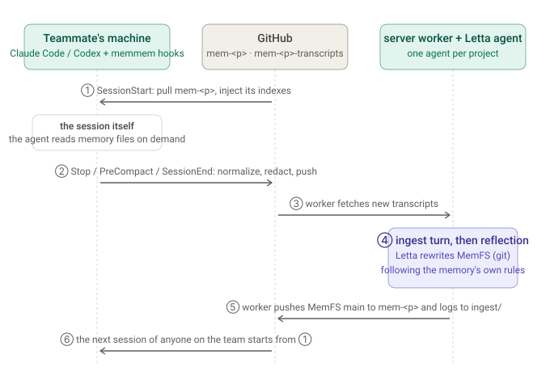
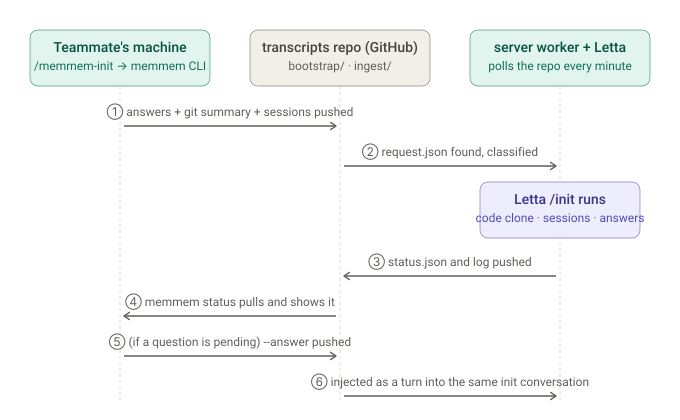
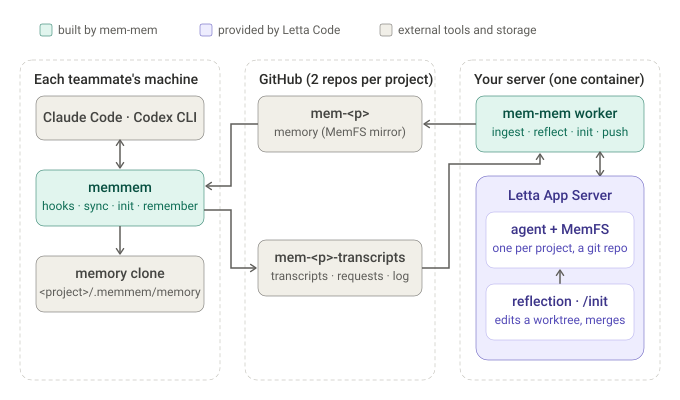

# mem-mem

Long-term memory for [Claude Code](https://claude.com/claude-code) and
[Codex CLI](https://github.com/openai/codex) projects, shared by everyone who
works on them and kept in your own GitHub repos. Built on
[Letta Code](https://github.com/letta-ai/letta-code).

Claude Code and Codex each remember things for one person on one machine.
mem-mem adds the layer above that: one memory per **project**, shared by
everyone who works on it, whichever agent they use. Every session starts with
the project's decisions, changes and context, and ends by feeding the memory.

- **Works with the agents you already use.** It plugs into Claude Code and
  Codex CLI through their own hooks and skills. No fork, no proxy, no MCP server
  to keep running.
- **One memory per project, shared by the people on it.** Everyone on the
  project reads and feeds the same memory, and it records who decided what, and
  when. Members are identified by their GitHub login.
- **Self-hosted, nothing new to trust.** The server is one container on a
  machine you own. The only things outside your machines are two private GitHub
  repos per project. There is no mem-mem service and no telemetry.
- **Small by design.** Letta Code provides the agent, its git-backed memory,
  reflection, memory initialization and transcript normalization, all
  unchanged. mem-mem is the glue: hooks, the two repos, a worker and two CLIs.

## How it works



1. **SessionStart.** A hook pulls the project's memory repo into
   `<project>/.memmem/memory` and injects a short context: the root index, the
   project and team files, and each folder's index. The agent reads any other
   memory file on demand from that path. The injection is a few thousand
   characters, not the whole memory.
2. **The session.** Nothing changes for the person. The agent has the team
   context and keeps working as usual. "remember ..." stores an explicit note.
3. **SessionEnd.** In long sessions a checkpoint also runs on `Stop` at most
   every 30 minutes and on `PreCompact`. The hook normalizes the transcript into
   Letta's trajectory format, redacts secret-like strings and pushes it to the
   transcripts repo in the background. Only new records travel.
4. **Ingest and reflection.** The server worker fetches new transcripts and
   feeds each to the project's Letta agent as one turn. After a few sessions,
   and once a day, it asks Letta to reflect. Reflection reads the agent's
   memory, decides what is worth keeping and rewrites it as a git commit. It
   follows the "Rules for reflection" written into the memory itself: one
   decision per file with its reason, alternatives, source sessions and status,
   and superseded decisions are marked rather than deleted. A reflection that
   finds nothing worth saving says so and saves nothing.
5. **Push and log.** The worker pushes the agent's memory to the memory repo and
   appends what happened (file, conversation, reflection outcome, commit) to
   `ingest/log.jsonl` in the transcripts repo.
6. **The next session** of anyone on the team starts from step 1 with the
   updated memory.

### Initializing a project

A new memory starts empty. `/memmem-init` (Codex: `$memmem-init`) asks four
questions in the coding agent (research depth, related repos, communication
style, consent to analyze past sessions), adapted from Letta's own
`initializing-memory` skill, and uploads what the server needs:



The server clones the code, lays out the approved past sessions and runs
Letta's own `/init` on the project agent, headless, passing it the answers. The
result is a few commits in the memory repo; `memmem status` follows progress and
relays any question the skill still has. Later teammates run the same command:
the server sees the project is already initialized and only adds their sessions,
or, if asked, re-runs the code research at a deeper level. A real project with
six past sessions took about six minutes.

## Design

mem-mem does not implement a memory system. Letta Code already has one for a
single developer: an agent with a git-backed memory (MemFS), reflection that
curates it, `/init` that seeds it from code and session history, and a
trajectory format for Claude Code and Codex transcripts. mem-mem runs Letta's
App Server on a machine of yours, creates one agent per project and feeds it the
team's sessions instead of one person's. Everything else is glue: hooks, two
repos, a worker and two CLIs.



| Component | Where | Does | Provided by |
|---|---|---|---|
| `memmem` | each teammate's machine | hooks for both agents, transcript sync, `setup`, `init`, `status`, `doctor`, `remember`, the skills | mem-mem |
| memory repo `mem-<project>` | GitHub | the memory, a mirror of the agent's MemFS; cloned into the project as `.memmem/memory` | you |
| transcripts repo `mem-<project>-transcripts` | GitHub | transcripts, explicit notes, init requests and status, member registry, the ingest log | you |
| `memmem-server` | your server | the worker (ingest, reflection, init, pushes) and the operator CLI | mem-mem |
| Letta App Server | your server, same container | the agent, MemFS, reflection, `/init`, model access | Letta Code |

**Two private GitHub repos per project** stand in for a database, a queue and an
inbound port. The memory repo is the source of truth: read it on GitHub, diff a
reflection, revert a bad one. The transcripts repo is the transport: teammates
push transcripts and requests, the server pulls them and pushes results back, so
it needs only outbound access. Access to a project's memory is access to its two
repos, and `ingest/log.jsonl` ties every memory change back to the sessions it
came from.

**A few decisions worth knowing.** One agent per project, because Letta scopes
memory to an agent. The worker drives reflection with an explicit instruction
and classifies the outcome (committed, nothing to save, failed) instead of
trusting a success flag. Everything runs on Letta Code's local backend; nothing
connects to Letta Cloud. Transcripts are redacted on the teammate's machine
before they leave it; redaction is best-effort, so keep the transcripts repo
private. The full design, with reasons, is in
[docs/design/architecture.md](docs/design/architecture.md).

## Install

**Server** (one machine for the team). With Docker, run the image
`ghcr.io/jaehyeokl/mem-mem-server` with the compose file in
[packages/server/README.md](packages/server/README.md); its data lives in two
volumes. Without Docker:

```bash
curl -fsSL https://raw.githubusercontent.com/jaehyeokl/mem-mem/main/scripts/install-server.sh | sh
```

The installer needs Node.js >= 24.22, npm and git, installs Letta Code if it is
missing, and downloads and verifies the `memmem-server` tarball from GitHub
Releases. Either way the server needs a GitHub login with access to the team's
repos and a model-provider login for Letta; `memmem-server setup` walks through
both with device codes.

**Client** (each teammate). A single binary for macOS, Linux and Windows, no
runtime to install:

```bash
curl -fsSL https://raw.githubusercontent.com/jaehyeokl/mem-mem/main/scripts/install.sh | sh
```

Windows: `irm https://raw.githubusercontent.com/jaehyeokl/mem-mem/main/scripts/install.ps1 | iex`.
The client needs `git`, push access to the team's repos (`gh auth setup-git` or
SSH), and `gh` to pick up your member handle (or pass `--member` to `setup`).
Neither package is on npm; GitHub Releases and the image are the distribution.

## Quick start

**Operator** (server), once per team and then once per project. In Docker,
`docker compose up -d` first and run the same commands through `docker exec`:

```bash
memmem-server setup                                  # checks, git identity, GitHub and model-provider logins
memmem-server project add acme --owner acme-org      # two repos, the agent, the memory layout (--language ko for Korean)
memmem-server start --detach                         # not needed in Docker: the container runs the worker
```

Afterwards `memmem-server status`, `logs`, `members` and `init status` follow
the server, and `model set` and `project add` work while it runs.

**Teammates** (client). Each one runs the same command in their checkout of the
project (it takes the member handle from `gh`):

```bash
memmem setup --project acme --memory-repo acme-org/mem-acme \
             --transcripts-repo acme-org/mem-acme-transcripts
```

By default nothing is written into the project's tracked files and nothing is
committed: the hooks and the `memmem-init` skill are installed once per
computer at the user level (`~/.claude/settings.json`, `~/.codex/hooks.json`,
`~/.agents/skills`), and the project only gets a `.memmem/` folder that git
ignores through `.git/info/exclude`. That works in a repository you share with
people who do not use mem-mem. Projects without `.memmem/` are left alone: the
hooks exit at once there, and what remains visible is the `memmem-init` entry
in the skill menu, Codex's one-time hook review screen, and Codex's own
`hook:` lines in plain `codex exec` output. `memmem install` refreshes the
user-level pieces, `memmem uninstall --user` removes them.

Codex users approve the memmem hooks once per computer on Codex's review
screen (again only if the hook definitions change). Then, in Claude Code,
`/memmem-init`; in Codex, `$memmem-init`. From then on every session in that
folder starts with the team memory and ends by shipping its transcript.

For a repository the team owns, `memmem setup --shared ...` is the 0.1.0
behaviour: it writes the hooks, skills, an `AGENTS.md` block and a few
`.gitignore` lines into the project for the first member to commit, and the
rest of the team runs `memmem setup` in their clones. Details in
[client/README.md](client/README.md).

```bash
memmem status            # ingest, reflection, init progress, your own contribution
memmem doctor            # hooks, clones, credentials, stale skills
memmem remember "..."    # an explicit note for the team memory
```

## Documentation

| Read this | For |
|---|---|
| [packages/server/README.md](packages/server/README.md) | Operator guide: install options, every `memmem-server` command, data directory, running as a service |
| [packages/server/WORKER.md](packages/server/WORKER.md) | How the worker ingests, reflects, classifies outcomes and init requests, and what it logs |
| [client/README.md](client/README.md) | Teammate guide: `memmem` commands, hooks, skills, data locations, environment variables |
| [docs/e2e-docker.md](docs/e2e-docker.md) | Contributor runbook: build the server image, run the whole loop against a test project, upgrade the container; known limitations |
| [docs/design/](docs/README.md#design) | Architecture, project initialization, packaging and language decisions, with the reasons |
| [docs/research/](docs/README.md#research) | What was measured about Letta Code before building on it |

## Development

```bash
npm ci
npm test --workspace mem-mem-client    # client
npm test --workspace memmem-server     # server
node client/scripts/build-bin.mjs      # single binaries (bun)
docker build -t mem-mem:dev -f packages/server/Dockerfile .
```

Layout, conventions and the release process are in
[CONTRIBUTING.md](CONTRIBUTING.md). Coding agents working on this repository:
read [AGENTS.md](AGENTS.md).

## License

Apache-2.0. See [LICENSE](LICENSE).
